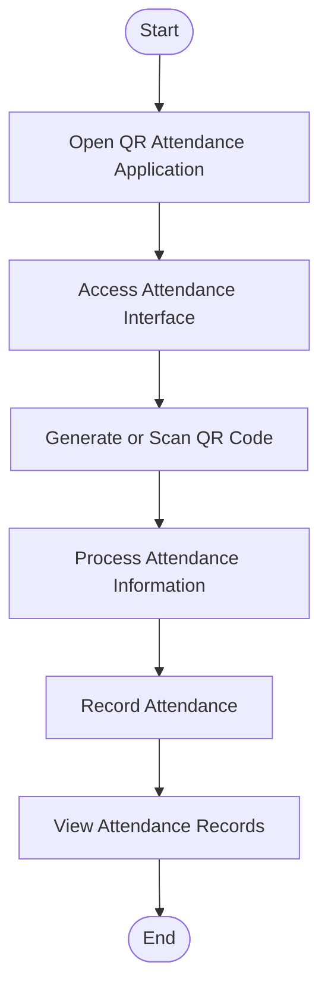

<div align="center">

# 🎓 QR Attendance System

### Simplifying Attendance Tracking Through QR Code Technology

A QR-based attendance management application designed to make attendance recording easier, faster, and more organized.

<br/>


</div>

---

## 📌 Overview

The **QR Attendance System** is a web-based application developed to simplify the process of recording and managing attendance using QR codes.

The system provides a digital alternative to traditional manual attendance methods. It is intended to make attendance recording more convenient while maintaining organized attendance information.

This project demonstrates the practical application of QR code technology and web application development.

## ✨ Features

- 📷 **QR Code-Based Attendance** – Use QR codes as part of the attendance recording process.
- ⚡ **Quick Attendance Recording** – Simplify the process of marking attendance.
- 📋 **Attendance Management** – Organize and manage recorded attendance information.
- 🖥️ **Web-Based Interface** – Access the application through a web browser.
- 📊 **Attendance Records** – View recorded attendance information.

> Update this list to match the features actually implemented in your project.

## 🛠️ Technology Stack

| Component | Technology |
|---|---|
| Frontend | `Add your frontend technology` |
| Backend | `Add your backend technology` |
| Database | `Add your database` |
| QR Code | `Add the QR library used` |
| Development Tools | `Add your tools` |

## ⚙️ Application Workflow



## 📂 Project Structure

```text
qr-attendance/
│
├── frontend/             # Frontend application
├── backend/              # Backend application
├── database/             # Database-related files
├── screenshots/          # Application screenshots
├── README.md
└── ...
```

> Modify the structure above to reflect your actual repository folders and files.

## 🚀 Getting Started

Follow these steps to run the project locally.

### Prerequisites

Install the tools required by your project:

- [Git](https://git-scm.com/)
- [Node.js](https://nodejs.org/) or the runtime used by your project
- Required database and development dependencies

### 1. Clone the Repository

```bash
git clone https://github.com/narendra-0821/qr-attendance.git
```

### 2. Navigate to the Project

```bash
cd qr-attendance
```

### 3. Install Dependencies

```bash
# Use the commands appropriate for your project
npm install
```

### 4. Configure the Application

Add the required environment variables and database configuration, if applicable.

### 5. Run the Application

```bash
# Replace with the actual startup command
npm start
```

## 📸 Screenshots

Add screenshots of your actual application here.

| Application Interface | Attendance Interface |
|---|---|
| Add screenshot here | Add screenshot here |

Example:

```markdown


```

## 🧠 Concepts Demonstrated

- QR code generation and scanning
- Web application development
- Frontend and backend integration
- Attendance data handling
- Database interaction, if implemented

## 🎯 Project Objective

The primary objective of this project is to explore how QR code technology can be used to improve attendance recording and management through a digital application.

## 🔮 Future Enhancements

- Enhanced attendance analytics and reports
- Improved authentication and access control
- Mobile-friendly user experience
- Additional attendance verification mechanisms

## 👨‍💻 Developer

**Narendra Machavarapu**

Electronics and Communication Engineering  
Embedded Systems | Software Development

🔗 **GitHub:** [narendra-0821](https://github.com/narendra-0821)

---

<div align="center">

### ⭐ If you find this project useful, consider giving it a star!

**Built with curiosity and a passion for technology.**

</div>
